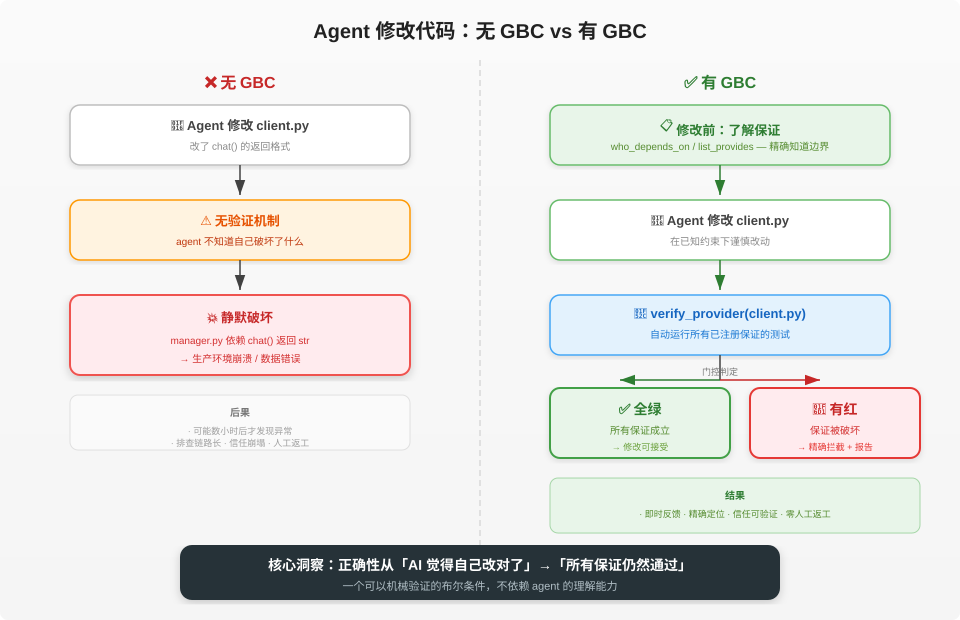

# Guarantee-Based Coding (GBC)

**把消费者依赖的行为登记成保证，让代码修改有可执行的验证依据。**

**English version: [docs/en/README.md](docs/en/README.md)**

GBC 把你在意的行为登记成一条条带测试的**保证（guarantee）**，并记录谁依赖它们。
修改后运行相关保证，可以看到哪些检查失败、哪些尚未执行，以及受影响的消费者。
GREEN 表示已执行项无失败；验收是否完整，还要检查所需保证是否实际执行、测试是否充分。

---

## 🚀 快速开始

```bash
pipx install guarantee-based-coding
gbc setup        # 打印本地化接线指南：怎么把 MCP / skills 接入你的 agent
```

装好后 `gbc` 命令即在 PATH 上。完整上手（安装 → 接入 agent → 冒烟验证）见
**[docs/zh/quick-start.md](./docs/zh/quick-start.md)**。

想让 agent 替你接入？把 **[docs/zh/onboarding-agent.md](./docs/zh/onboarding-agent.md)** 交给它。

---

> 🚧 **交互式 demo 施工中**：旧的演示套件已废弃，新的交互式演示正在筹备。目前请直接读文档上手。

---

## 📚 文档

| 你想 | 看这里 |
|------|--------|
| 装好并跑起来 | [快速开始](./docs/zh/quick-start.md) |
| 懂 GBC 在保护什么 | [核心概念](./docs/zh/concepts.md) |
| 在 GBC 下安全改代码 | [工作流](./docs/zh/workflow.md) |
| 查命令 / 工具 / executor | [参考手册](./docs/zh/reference.md) |
| 你是 agent，被要求接入 GBC | [Agent 上手](./docs/zh/onboarding-agent.md) |

English docs: [docs/en/](./docs/en/)。

安装后也能离线查询同版本手册：`gbc doc list --lang zh`、`gbc doc read quick-start --lang zh`、
`gbc doc search "保证" --lang zh`。`--help` 仍用于查简短命令语法。

**0.4.0** 在 0.3.0 的命令职责与离线手册基础上，完善意图起草、保证测试和术语 / 决策复用工作流。
0.3.0 中项目架构意图入口由 `gbc doc` 改为 `gbc intent`，MCP 的八个意图工具由 `doc_*`
改为 `intent_*`，不保留旧别名。此后的 `gbc doc` 专门查询 GBC 手册。

0.4.0 增加可配合 MCP 或 CLI 使用的 **gbc-workflow** skill：先查证据再起草意图、保护消费者
行为的保证测试，以及术语与决策理由复用。**gbc-cli** 保留为命令适配器；用 `gbc setup` 查询
随包路径，按客户端需要在项目内接入，不自动全局安装。详见[工作流](./docs/zh/workflow.md)。

---

## 核心想法

代码之间的依赖本质上是一组**保证**。模块 A 依赖模块 B，不是依赖它的实现细节，而是依赖它的某些
行为承诺——返回值的类型、格式、语义。把这些保证从隐含变成**显式、可执行、可验证**，
让修改判断有已登记测试的执行结果作为依据。GBC 运行项目自管测试，不能自动识别被削弱的断言，
也不能证明未登记的行为；契约和测试变更仍需审查。



GBC **不是**另一个要挑战 Cursor / Aider 的 AI 编程助手，而是填补它们在大型项目里缺的一环：
**具名承诺、消费者关系与可执行检查**。它与那些 agent 配合——改前查相关依赖，开发期灵活获得
测试反馈，最终经 GBC 验证相关保证。它也可配合 CI；是否形成强制门禁取决于项目的接入和权限设置。

完整概念、架构图、与已有概念（Design by Contract / 测试）的区别，见
[核心概念](./docs/zh/concepts.md)。

---

## 当前状态

GBC 目前是一个可用的 Python 分发包（`pipx install guarantee-based-coding`），自身用 GBC 管理自己的
`.gbc/`（dogfooding）：

- ✅ 核心保证机制（具名 id、多对一、出生即绿、退休保护、反查）
- ✅ 多语言 executor 配置
- ✅ CLI + MCP 双接口（含意图文档 `gbc intent` 全进 MCP）
- ✅ 意图文档子系统（`gbc intent` / web 编辑器）
- ✅ 随包接线指南（`gbc setup`）、通用于 MCP / CLI 的工作流 skill 与 CLI 命令适配 skill
- ✅ 原子文件写入 + 备份


**诚实的局限**：保护能力上限 = 测试质量（聚焦 happy path 可保护相应承诺，但不能代表未覆盖的错误或边界）；依赖需主动登记，
覆盖率随项目增长需持续投入；每次验证真实跑测试，有一定延迟。详见
[核心概念 · 局限性](./docs/zh/concepts.md#局限性诚实地说)。

---

## 许可

本项目采用 [Apache-2.0](./LICENSE) 许可证。

## 联系

如果你对这个方向感兴趣，欢迎 star、issue 或者直接联系我。
