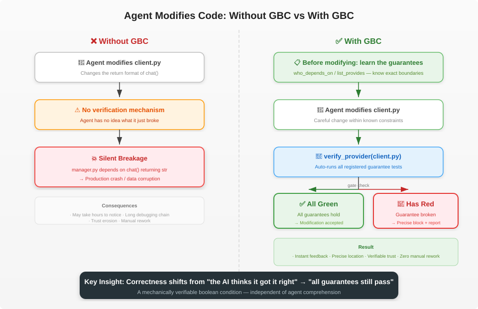

# Guarantee-Based Coding (GBC)

**Register the behaviors consumers rely on, and back code changes with executable evidence.**

**中文版本: [README.md](../../README.md)**

GBC registers the behaviors you care about as test-backed **guarantees** and records their
consumers. After a change, run related guarantees to see failed checks, unexecuted guarantees
and affected consumers. GREEN means no executed guarantee failed; complete acceptance also
requires that the needed guarantees ran and their tests adequately protect the behavior.

---

## 🚀 Quick start

```bash
pipx install guarantee-based-coding
gbc setup        # prints a localized wiring guide: how to connect MCP / skills to your agent
```

The `gbc` command is now on your PATH. Full onboarding (install → wire into your agent → smoke
test) is in **[docs/en/quick-start.md](quick-start.md)**.

Want your agent to wire it in for you? Hand it
**[docs/en/onboarding-agent.md](onboarding-agent.md)**.

---

> 🚧 **Interactive demo under construction**: the old demo suite is deprecated and a new interactive demo is in the works. For now, start directly from the docs.

---

## 📚 Documentation

| You want to | Go here |
|-------------|---------|
| Install and get running | [Quick Start](quick-start.md) |
| Understand what GBC protects | [Core Concepts](concepts.md) |
| Change code safely under GBC | [Working under GBC](workflow.md) |
| Look up a command / tool / executor | [Reference](reference.md) |
| You're an agent asked to wire GBC in | [Agent Onboarding](onboarding-agent.md) |

Chinese docs: [docs/zh/](../zh/).

Installed GBC also includes an offline manual for that version: `gbc doc list --lang en`,
`gbc doc read quick-start --lang en`, and `gbc doc search "guarantee" --lang en`.
`--help` continues to provide short command syntax.

**0.4.0** builds on 0.3.0's command organization and offline manuals with improved intent drafting,
guarantee tests, and vocabulary/decision reuse.
In 0.3.0, project intent moves from `gbc doc` to `gbc intent`, and the eight intent MCP tools
move from `doc_*` to `intent_*`, without compatibility aliases. `gbc doc` now queries the GBC manual.

0.4.0 adds **gbc-workflow** for either MCP or CLI: evidence-first intent drafting, guarantees that
protect consumer behavior, and vocabulary/decision reuse. **gbc-cli** remains the command adapter.
Use `gbc setup` to locate bundled files and integrate at project level when your client needs it;
no automatic global installation. See [workflow.md](./workflow.md).

---

## The core idea

Dependencies between code are essentially a set of **guarantees**. Module A depends on module B not
on its implementation details, but on some of its behavioral promises — the type, format, semantics
of return values. Make those guarantees **explicit, executable, and verifiable** to support
change decisions with registered test results. GBC runs project-owned tests; it cannot
automatically detect weakened assertions or prove unregistered behavior. Contracts and test
changes still need review.



GBC is **not** another AI coding assistant challenging Cursor / Aider — it fills the piece they lack
in large projects: **named promises, consumer relationships and executable checks**. It works
with those agents: inspect relevant dependencies, obtain development feedback flexibly, then
verify affected guarantees through GBC for final acceptance. It can also work with CI;
enforcement depends on the project's integration and permissions.

Full concepts, architecture diagram, and how it differs from existing ideas (Design by Contract /
testing) are in [Core Concepts](concepts.md).

---

## Current status

GBC is a working Python distribution package (`pipx install guarantee-based-coding`), and it manages
its own `.gbc/` with GBC (dogfooding):

- ✅ Core guarantee mechanism (named ids, many-to-one, born-green, retirement protection, reverse
  lookup)
- ✅ Language-agnostic executor config
- ✅ CLI + MCP dual interface (intent docs `gbc intent` fully exposed over MCP)
- ✅ Intent-document subsystem (`gbc intent` / web editor)
- ✅ Bundled wiring guide (`gbc setup`), workflow skill for MCP / CLI, and CLI command adapter skill
- ✅ Atomic file writes + backups


**Honest limitations**: protection ceiling = test quality (a focused happy-path test can protect
its promise, but not untested errors or boundaries); dependencies must be registered actively, and coverage takes ongoing investment as the
project grows; every verification really runs tests, so there's some latency. See
[Core Concepts · Limitations](concepts.md#limitations-stated-honestly).

---

## License

This project is licensed under [Apache-2.0](../../LICENSE).

## Contact

If this direction interests you, stars, issues, or reaching out directly are all welcome.
