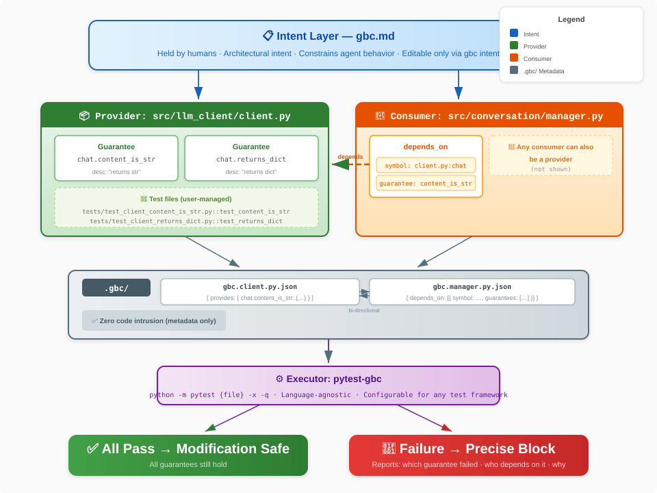

# Core Concepts

> Language: [简体中文](../zh/concepts.md) | **English**

This page explains GBC's core concepts — what it actually protects, and how. To get hands-on first
see [quick-start.md](./quick-start.md); for the workflow see [workflow.md](./workflow.md).

---

## The problem: when changing code, how do you know what must not break?

A coding agent can overlook **implicit assumptions that other code relies on**. Changing a
function's return format can break another module. When those dependencies are not recorded
and the relevant behavior is not covered by tests, a local edit can cause an unnoticed regression.

## The core idea: turn implicit dependencies into explicit guarantees

Module A often depends on module B's behavioral promises: the type, format, or semantics of its
results. GBC registers these promises as **named, test-backed guarantees** and records their
consumers. This lets an agent:

- Inspect the promises and registered consumers relevant to a change;
- Run the associated tests to check the behavior they cover;
- Locate the failing guarantee and use consumer relationships to assess impact.

These checks provide executable evidence. Passing them does not prove the entire change correct
or establish anything about behavior that was not checked or covered.

---

## Architecture



### Three design principles

1. **Zero source intrusion**: all metadata lives under the target project's `.gbc/` directory —
   no source edits, no decorators/annotations.
2. **Tests are user-owned**: GBC does not generate, store, or manage the test files themselves.
   You organize tests your own way in your own project; GBC only **records which test backs which
   guarantee, runs them, and aggregates results**.
3. **Language-agnostic**: any language and test framework, via executor config.

---

## Two layers of contract

GBC pins down the impact of a change with two layers:

1. **Intent layer**: in `.gbc/**/gbc.md`. Natural language (Markdown) defining a folder's role,
   internal constraints, and architectural intent. It is the source of truth — it tells an agent
   "what you should and shouldn't do here." **Human-held**; the agent maintains it within granted authority.
2. **Guarantee layer**: in `.gbc/**/*.json`. Executable, test-backed concrete behavioral promises.

When changing code, the agent must honor both the intent layer (don't violate the original purpose)
and the guarantee layer (don't break concrete behavior).

How to write intent docs (the three sections: intent / internal constraints / files) is in
[workflow.md](./workflow.md#writing-intent-docs).

---

## The intent document system (gbc.md)

The behavior layer guards "behavior doesn't break"; the intent layer guards "direction doesn't
drift" — both are pre-change defenses, but of different natures: guarantees are mechanically
verifiable (born-green / verify), while intent relies on **human-held authority + tool consistency**.

### What it is

Each folder's intent lives in `.gbc/<path>/gbc.md`, made of three sections that are really
**visibility scopes**:

| Section | Answers | Who needs to know |
|---|---|---|
| **Intent** | What this is and why it exists | Outside (public contract) |
| **Internal constraints** | What it must / must never do | Internal coordination (package-private) |
| **Files** | Subfolders + file list, one role line each | Only the file itself (private) |

When unsure whether something is "intent vs constraint", ask per sentence: "who needs to know
this?". It only records the **current state** (what it is now, what it must do now), not diffs
against the past — phase words, roadmaps, and migration narratives are drift bait.

### How it is maintained

- **Hierarchy**: a subfolder's intent auto-projects into its parent's entry; parent/child
  consistency is a **deterministic constraint** maintained by the `gbc intent` tools (`intent check`
  reports DRIFT / ORPHAN, `intent sync` repairs).
- **The only compliant entry**: `gbc intent` (CLI / MCP intent tools). Never hand-edit — hand-editing
  drifts the deterministic constraint, downgrading "verifiable truth" to "best-effort habit".
- **Spec-first**: investigate the relevant evidence first. If existing intent covers the task,
  use it; if it must change, draft the delta, obtain any missing authorization required by the
  project's rules, and land it before implementation. Routine implementation, helper-file splits,
  and file-entry maintenance within an authorized goal and responsibility need no repeated
  architectural approval. Changes to purpose, responsibilities, compatibility, authority, or
  important constraints need corresponding authorization. See [workflow.md](./workflow.md) and the **gbc-workflow** skill
  for consequential questions, vocabulary reuse, and preserving decision reasons with MCP or CLI.

### How it relates to the guarantee layer

Intent describes current responsibilities and boundaries, with references to ADRs for decision
reasons where useful. **An intent check cannot prove code follows natural-language constraints**;
it checks document structure and parent/child projection consistency. Guarantees run tests for
specific behavior. The layers support design judgment and behavioral acceptance respectively.

### How to treat it

It is a **snapshot of the current state, not a sacred text**: born to prevent drift, not to
freeze the architecture. Found it wrong, or it starts blocking reasonable evolution? Draft the
delta → obtain any missing authorization → land through the tools — legitimate evolution, not a violation.
Piling responsibilities into one file instead of changing the intent (a god file) is exactly the
drift-guard mechanism turned upside down. For an agent: **read it (map before acting), obey it
(stay in scope), propose changes to it (through the official channel) — but don't own it.**

---

## Core terms

- **Provider**: the source file that offers a guarantee (e.g. `src/llm_client/client.py`).
- **Consumer / Dependent**: a file depending on a guarantee (e.g. `src/conversation/manager.py`).
- **Guarantee**: a **named** behavioral promise (id shaped `<symbol>.<behavior>`, path-free),
  backed by a test + a description. **Multiple consumers may share one guarantee.**
- **Executor**: config defining how to run tests (command template, working dir, env vars, ...).

### Two tiers of dependency edge

- **Symbol dependency (free)**: depends only on a signature or a symbol existing; no test, no
  reverse edge.
- **Named guarantee dependency**: depends on concrete behavior. Registered **both ways** via the
  reverse-edge mechanism — the provider's `provides[id].dependents` ⇄ the consumer's
  `depends_on[].guarantees`, kept in sync by the tooling.

> Default to free symbol dependencies; upgrade to a named guarantee **only** when you depend on
> concrete behavior (not just a signature), and upgrade lazily.

---

## The unbreakable core invariants

Whichever surface you swap in — CLI / MCP / a future GUI — these engine-level invariants hold:

- **Guarantees are first-class; identity is a named id** (e.g. `get_config.never_none`, ≠ a test
  path).
- **Many-to-one**: one guarantee can be shared by many consumers; hitting an existing one appends
  a dependent and reuses it, rather than writing a second test.
- **Two-section self-contained meta**: one `.gbc` json per code file, `provides` (as provider) +
  `depends_on` (as consumer).
- **Born-green**: for normally enabled guarantees, formal creation and test/executor updates run
  the test on the spot and refuse the change if it fails. Development may run unregistered tests directly in the correct
  environment, with optional red-first and no mandatory replay; do not disable guarantees for TDD.
  Passing this gate does not establish defect sensitivity; the test must protect the consumer's
  actual behavior, including exact values when contractual (see [workflow.md](./workflow.md#narrow-test-rule)).
- **Retirement protection**: a guarantee with dependents refuses deletion.
- **Binary gate**: a test that ran is pass or fail; one that was skipped (heavy) is reported loudly
  but never turns the gate red. Green = no failures, not complete acceptance. Report heavy skips,
  disabled guarantees, and zero execution as unverified scope during final GBC acceptance.
- **heavy** is a cost rank (int) + an auto-run authorization: batch runs only heavy ≤ threshold;
  a named verify ignores it.

### What a meta file looks like

`client.py` (provider), at `.gbc/src/llm_client/gbc.client.py.json`:

```json
{
  "provides": {
    "chat.content_is_str": {
      "desc": "chat()'s result['content'] is a str; manager concatenates it into history directly",
      "test": "tests/test_client_content_is_str.py::test_content_is_str",
      "executor": "pytest-myproject",
      "heavy": 0,
      "dependents": ["src/conversation/manager.py"]
    }
  }
}
```

`manager.py` (consumer), at `.gbc/src/conversation/gbc.manager.py.json`, records the reverse edge:

```json
{
  "depends_on": [
    {
      "symbol": "src/llm_client/client.py:chat",
      "guarantees": ["chat.content_is_str"]
    }
  ]
}
```

Both directions are written by the tools (CLI / MCP); you don't hand-edit them.

---

## What it is not

GBC works with existing coding agents through CLI / MCP, supplying architectural context, named
promises, consumer relationships, and test results. The agent understands the task, edits code,
and fixes failures. GBC does not discover every dependency, monitor every edit, or repair code
itself. Whether failures block commits or merges depends on integration and permissions.

### How it differs from existing ideas

**"Isn't this an ADR?"** ADRs capture important decisions with their context, trade-offs, and
consequences. GBC's intent documents maintain current responsibilities, constraints, and file
roles; guarantees connect concrete promises to checks. Keep existing ADRs and reference them
where useful, without copying the decision history into the current contract. Matt Pocock's
[domain-modeling](https://github.com/mattpocock/skills/blob/main/skills/engineering/domain-modeling/SKILL.md)
also supports context-scoped ADRs, checking code, and surfacing contradictions. Splitting documents
or giving immediate feedback does not, on its own, distinguish GBC.

**"Isn't this AGENTS.md?"** [AGENTS.md](https://agents.md/) supplies project context and working
instructions and supports nested files. GBC adds a tool-maintained intent hierarchy, named
guarantees, and consumer relationships that can be queried around target files. AGENTS.md can
direct an agent to use GBC; the two work together.

**"Isn't this CI/CD?"** CI/CD orchestrates builds, checks, and delivery and can give fast feedback.
For example, [GitHub Actions](https://docs.github.com/en/actions/get-started/understand-github-actions)
supports event-based, manual, and scheduled triggers. GBC organizes relied-on promises and their
checks; agents can call it while editing, and CI can run it too. The distinction is responsibility
and data relationships, not before versus after a commit.

**"Isn't this testing?"** A guarantee is a named behavioral promise referencing a project-owned
test selector and executor, not a test file. GBC records providers and consumers, maintains both
directions of their relationship, and refuses to retire guarantees that still have consumers.
Agents can inspect who relies on what and run the related checks. GBC does not replace a test
framework or judge assertion sufficiency.

**"Isn't this Design by Contract?"** Both make behavioral contracts explicit. GBC keeps named
promises, test references, and consumer relationships in metadata outside the source to support
change context and test verification. It requires no contract annotations in business code and
does not inject runtime precondition or postcondition checks.

---

## Limitations (stated honestly)

- **Protection ceiling = test quality**: GBC runs user-maintained tests and only catches what those
  tests can catch. A focused happy-path test may protect its promise; weak assertions or replacing
  the protected behavior with a mock may not. Review contract and test changes; centralizing the
  execution entry point cannot by itself detect weakened assertions.
- **Manual registration cost**: dependencies must be registered by an agent or human. The per-edge
  cost is small, but coverage takes ongoing investment as the project grows.
- **Run performance**: every verification really runs tests, so there's some latency cost.
