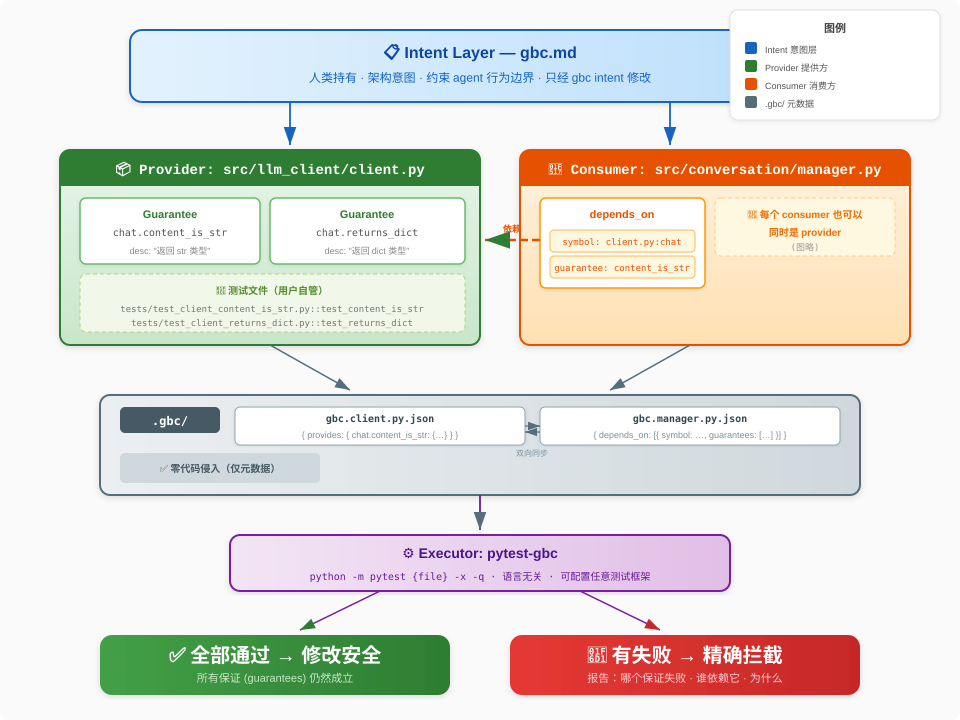

# 核心概念

> 语言：**简体中文** | [English](../en/concepts.md)

本页解释 GBC 的核心概念——它到底在保护什么、怎么保护。要动手的话先看
[quick-start.md](./quick-start.md)，要工作流看 [workflow.md](./workflow.md)。

---

## 问题：修改代码时，怎么知道什么不能被破坏？

Coding agent 修改代码时，一个容易遗漏的问题是**破坏其他代码依赖的隐含假设**。
当 agent 改了一个函数的返回格式，其他模块可能因此失效。如果这些依赖没有明确记录，相关行为
也没有被测试覆盖，局部修改就可能带来难以察觉的连带破坏。

## 核心想法：把隐含依赖变成显式保证

模块 A 依赖模块 B，往往是依赖它的某些行为承诺——返回值的类型、格式、语义。
GBC 把这些承诺登记为**具名、由测试支撑的保证**，并记录消费者关系，让 agent 能够：

- 围绕修改对象查到相关承诺和已登记的消费者；
- 运行保证关联的测试，检查它们覆盖的行为是否仍成立；
- 将失败定位到具体保证，并依据消费者关系评估影响。

这些检查为修改提供可执行证据；通过检查不等于证明整个修改正确，也不代表未执行或未覆盖的行为。

---

## 架构



### 三条设计原则

1. **源码零侵入**：所有元数据存在目标项目的 `.gbc/` 目录下，不改源代码、不加装饰器/注解。
2. **测试文件用户自管**：GBC 不生成、不存储、不管理测试文件本身。你在自己项目里用自己喜欢的
   方式组织测试；GBC 只**记录哪些测试对应哪些保证、运行它们、汇总结果**。
3. **语言无关**：通过 executor 配置支持任何语言和测试框架。

---

## 两层契约

GBC 用两层契约锁定变更影响：

1. **意图层（Intent）**：存于 `.gbc/**/gbc.md`。用自然语言（Markdown）定义文件夹的职责、
   内部约束和架构意图。它是「真理之源」，告诉 agent「你在这里该做什么、不该做什么」。由**人类
   持有**，agent 在授权范围内维护。
2. **行为层（Guarantee）**：存于 `.gbc/**/*.json`。可执行、被测试覆盖的具体行为承诺。

改代码时，agent 必须同时遵守意图层（不违背初衷）和行为层（不破坏具体功能）。

意图文档怎么写（三段式：意图 / 内部约束 / 文件），见 [workflow.md](./workflow.md#意图文档怎么写)。

---

## 意图文档系统（gbc.md）

行为层守护「行为不坏」，意图层守护「方向不漂移」——两者都是修改前的防御，但性质不同：
保证可机械验证（born-green / verify），意图靠**人类持有的授权边界 + 工具一致性**维护。

### 它是什么

每个文件夹的意图存在 `.gbc/<path>/gbc.md`，由三段构成，三段其实是**可见性作用域**：

| 段 | 回答 | 谁需要知道 |
|---|---|---|
| **意图（Intent）** | 这里是什么、为什么存在 | 外部（public 契约） |
| **内部约束（Internal constraints）** | 必须做什么、绝不做什么 | 内部文件协调（package-private） |
| **文件（Files）** | 子文件夹 + 文件清单，每个一行角色 | 仅该文件自己（private） |

分不清「意图 vs 约束」时，逐句问「谁需要知道这句话」。它只写**现状**（现在是什么、现在
必须怎样），不写与过去的 diff——阶段词 / 路线图 / 迁移叙事是漂移诱饵。

### 它怎么被维护

- **层级组织**：子文件夹的意图自动投影进父文件夹条目；父子一致性是**确定性约束**，由
  `gbc intent` 工具维护（`intent check` 报 DRIFT / ORPHAN，`intent sync` 修复）。
- **唯一合规入口**：`gbc intent`（CLI / MCP intent 工具）。绝不手编——手编 = 让确定性约束漂移，
  把「可校验的真」降级成「靠自觉的假」。
- **spec-first**：先调查相关证据。现有意图覆盖任务时直接沿用；确需改变时，起草增量、按项目
  规则取得尚缺的授权并落库后实现。已授权目标与职责内的普通实现、辅助文件拆分和文件条目维护
  无需重复架构审批；改变用途、职责、兼容性、权限或重要约束才需相应授权。
  实质问题、术语复用和决策理由的处理见 [workflow.md](./workflow.md)
  及 **gbc-workflow** skill，MCP / CLI 均可使用。

### 它和保证层的关系

意图层描述当前职责与边界，必要时引用 ADR 中的决策理由。自然语言约束是否被代码遵守，
**不能由 intent check 证明**；该工具检查文档结构和父子投影的一致性。保证层通过运行测试检查
具体行为。两层分别为设计判断和行为验收提供依据，互为补充。

### 怎么对待它

它是**现状快照，不是圣旨**：为防漂移而生，不为冻结架构而存在。发现它不合理、或它开始阻塞
合理演进？起草增量 → 取得尚缺的授权 → 经工具落库——正当演进，不是违规。把职责堆进一个文件而不改
意图（上帝文件），正是防漂移机制的本末倒置。对 agent 而言：**读它（动手前的地图）、遵它（不
越界）、提议改它（走正式通道），但不拥有它**。

---

## 核心术语

- **Provider**：提供保证的源文件（如 `src/llm_client/client.py`）。
- **Consumer / Dependent**：依赖某保证的文件（如 `src/conversation/manager.py`）。
- **Guarantee**：一条**具名**（id 形如 `<symbol>.<behavior>`，路径无关）的行为承诺，对应一个
  测试 + 一段描述。**多个 consumer 可共享同一条保证。**
- **Executor**：定义如何运行测试的配置（命令模板、工作目录、环境变量等）。

### 依赖边的两个层级

- **符号依赖（免费）**：只依赖签名或符号存在，无测试、无反向边。
- **具名保证依赖**：依赖具体行为。通过反向边机制**双向登记**——提供方的
  `provides[id].dependents` ⇄ 消费者的 `depends_on[].guarantees`，由工具链保证状态同步。

> 默认用免费符号依赖；**只**在依赖具体行为（而非签名）时才升级为具名保证，且懒升级。

---

## 不可破的本体不变量

无论换 CLI / MCP / 未来 GUI 哪种表面，这些引擎级不变量都不变：

- **保证是一等公民、身份是具名 id**（如 `get_config.never_none`，≠ 测试路径）。
- **多对一**：一条保证可被多个消费者共享；命中已有保证则追加 dependent 复用，不另写测试。
- **双段自包含 meta**：每个代码文件一份 `.gbc` json，`provides`（作 provider）+ `depends_on`
  （作 consumer）。
- **出生即绿（born-green）**：正常启用保证的正式创建及测试 / executor 更新时当场跑，不过则拒绝变更。
  开发期可在正确环境中直接运行未登记测试，先红再绿可选且不强制回放；不为 TDD 停用保证。
  通过门禁不代表测试具有缺陷辨识力；测试仍须保护消费者实际依赖的行为，包括属于契约的精确值
  （见 [workflow.md](./workflow.md#窄测试准则)）。
- **退休保护**：仍有 dependents 的保证拒绝删除。
- **门禁二元**：跑了的测试只有过 / 挂；没跑的（heavy 跳过）响亮报告但不染红。green = 无
  failed，不等于验收完整。最终 GBC 验收须把 heavy 跳过、停用保证和零执行明确列为未验证范围。
- **heavy** 是成本秩（int）+ 自动运行授权：批量只跑 heavy ≤ 阈值，点名 verify 无视它。

### Meta 文件长什么样

`client.py`（provider）的 `.gbc/src/llm_client/gbc.client.py.json`：

```json
{
  "provides": {
    "chat.content_is_str": {
      "desc": "chat() 返回的 result['content'] 是 str；manager 直接用它拼接对话历史",
      "test": "tests/test_client_content_is_str.py::test_content_is_str",
      "executor": "pytest-myproject",
      "heavy": 0,
      "dependents": ["src/conversation/manager.py"]
    }
  }
}
```

`manager.py`（consumer）的 `.gbc/src/conversation/gbc.manager.py.json` 登记反向边：

```json
{
  "depends_on": [
    {
      "symbol": "src/llm_client/client.py:chat",
      "guarantees": ["chat.content_is_str"]
    }
  ]
}
```

两个方向都由工具（CLI / MCP）双向写入，你不手编。

---

## 它不是什么

GBC 通过 CLI / MCP 配合已有 coding agent，提供架构上下文、具名行为承诺、消费者关系和测试结果。
agent 负责理解任务、修改代码和修正失败。GBC 不会自动发现所有依赖、监视每次编辑或自行修复代码；
是否强制阻止提交或合并，取决于项目的接入和权限设置。

### 和已有概念的区别

**「这不就是 ADR 吗？」** ADR 记录重要决定及其背景、取舍和后果。GBC 的意图文档维护当前
职责、约束和文件角色，保证层再连接具体承诺与检查。已有 ADR 可以继续使用，由意图文档引用；
无需把讨论历史复制成当前契约。Matt Pocock 的
[domain-modeling](https://github.com/mattpocock/skills/blob/main/skills/engineering/domain-modeling/SKILL.md)
也支持按上下文组织 ADR、核对代码和澄清矛盾，因此“分片”或“即时纠正”本身不是区分两者的依据。

**「这不就是 AGENTS.md 吗？」** [AGENTS.md](https://agents.md/) 为 agent 提供项目上下文和工作指令，
也支持按目录嵌套。GBC 进一步提供由工具维护的意图层级、具名保证及消费者关系，并可围绕目标文件
查询这些信息。AGENTS.md 可以规定何时使用 GBC，两者可以配合。

**「这不就是 CI/CD 吗？」** CI/CD 编排构建、检查和交付，也可以提供快速反馈；例如
[GitHub Actions](https://docs.github.com/en/actions/get-started/understand-github-actions) 支持事件、手动和定时触发。
GBC 组织被依赖的承诺及其检查，可以由 agent 在修改过程中调用，也可以接入 CI。
区别在于职责和数据关系，不在于“提交前”或“提交后”。

**「这不就是测试吗？」** 保证是一条具名行为承诺，引用项目自管的测试选择器和执行器；
它不等于测试文件。GBC 还记录提供方与消费者，维护双向关系，并拒绝退休仍有消费者的保证。
这些关系让 agent 能查到谁依赖什么，再运行相应检查。GBC 不替代测试框架，也不判断断言是否充分。

**「这不就是 Design by Contract 吗？」** 两者都显式描述行为契约。GBC 将具名承诺、测试引用
及消费者关系保存在源码外的元数据中，服务于修改上下文和测试验证。它不要求业务代码添加契约
注解，也不自行注入运行时前置或后置条件检查。

---

## 局限性（诚实地说）

- **保护能力上限 = 测试质量**：GBC 执行用户维护的测试，只能拦这些测试能抓到的错误。聚焦的
  happy-path 测试可能足以保护承诺，过弱断言或替换被保护行为的 mock 则可能无效。须审查契约
  与测试变更，统一执行入口本身无法识别削弱断言。
- **手动登记负担**：依赖关系需 agent 或人类主动登记。单次开销小，但覆盖率随项目增长需要持续
  投入。
- **运行性能**：每次验证都真实跑测试，有一定延迟成本。
